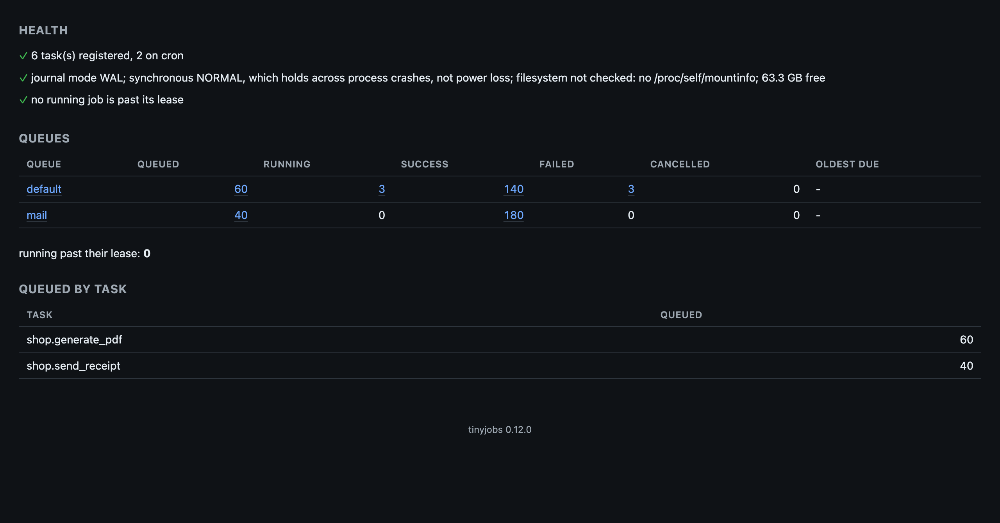

# tinyjobs

[](https://pypi.org/project/tinyjobs/)
[](https://pypi.org/project/tinyjobs/)
[](LICENSE)
[](https://tinyjobs.readthedocs.io/)
[](https://pepy.tech/projects/tinyjobs)

**No broker, no result backend, no daemon. The queue is a file.**

Background jobs and cron for Python, on SQLite with nothing to install, or on Postgres or Redis
with the same code. Django 6 ships `django.tasks`, a standard API for background tasks, without a
worker to run them: tinyjobs is that worker. FastAPI can run it inside the server process.

Ten hours of steady load on one SQLite file, 897,300 jobs, a `SIGKILL` every twenty minutes:
nothing lost. [Measured](https://tinyjobs.readthedocs.io/en/latest/measured/) has the numbers,
and `tinyjobs verify` reruns the experiment on your own store.



```bash
pip install tinyjobs
```

Python 3.12 or newer.

## Quick start

```python
# tasks.py
from tinyjobs import TinyJobs

app = TinyJobs("sqlite:///jobs.db")


@app.task
async def generate_pdf(document_id: int) -> str:
    ...


@app.task(max_attempts=5, timeout=300)
def transcode(video_id: int) -> None:
    ...


@app.task(cron="30 2 * * *", timezone="Europe/Rome")
def nightly_report() -> None:
    ...
```

```python
from tasks import generate_pdf

job = generate_pdf.enqueue(123)     # or: await generate_pdf.aenqueue(123)
job.refresh().status                # queued -> running -> success
```

```bash
tinyjobs worker --app tasks:app --concurrency 8
```

Every worker also fires the cron schedules, once per due time however many workers run.
[Jobs](https://tinyjobs.readthedocs.io/en/latest/jobs/) covers results, waiting and the `jobs`
commands, [Cron](https://tinyjobs.readthedocs.io/en/latest/cron/) the schedules.

## Using Django?

```python
# settings.py
INSTALLED_APPS = [..., "tinyjobs.contrib.django"]

TASKS = {
    "default": {
        "BACKEND": "tinyjobs.contrib.django.TinyJobsBackend",
        "OPTIONS": {"url": "sqlite:///jobs.db"},
    }
}
```

```python
# shop/tasks.py
from django.tasks import task


@task
def send_receipt(order_id: int) -> None:
    ...


send_receipt.enqueue(42)
```

```bash
python manage.py tinyjobs worker
```

Queues, priorities, `run_after`, async tasks and the signals all work, and on Postgres an enqueue
inside `transaction.atomic()` commits or rolls back with it.
[Django](https://tinyjobs.readthedocs.io/en/latest/django/) has the rest.

## Using FastAPI?

```python
from fastapi import FastAPI
from tasks import app as jobs, generate_pdf

api = FastAPI(lifespan=jobs.lifespan(worker=True))


@api.post("/documents/{document_id}/pdf")
async def render(document_id: int) -> dict:
    job = await generate_pdf.aenqueue(document_id)
    return {"job": job.id}
```

`uvicorn main:api` is the whole deployment: the worker runs inside the server, and in-flight jobs
finish before it exits. Leave out `worker=True` to run the workers elsewhere.
[FastAPI](https://tinyjobs.readthedocs.io/en/latest/fastapi/) has the details.

## What you get

| | |
| --- | --- |
| Async and sync tasks | `async def` on the worker's loop, `def` in a thread pool, `isolated=True` in a process of its own |
| Retries | exponential backoff with jitter, per-exception policy, `Retry` and `Abandon` |
| Cron | timezones and DST, misfire and overlap policies, fired from every worker with no leader |
| Queues, priorities, delays | `queue=`, integer priorities, `delay=60` or `run_at=<datetime>` |
| Deduplication | `key="invoice:123"` collapses duplicate enqueues |
| Crash recovery | leases and heartbeats, so a killed worker's jobs come back |
| Transactional enqueue | on Postgres, a job commits or rolls back with your own transaction |
| Attempt history | every attempt is a row, with its traceback and timings |
| Retention | old jobs are pruned, so the database plateaus instead of growing |
| Watching | hooks, job fields on every log line, `--log-format json`, Prometheus metrics, `tinyjobs check` for probes |
| Dashboard | `tinyjobs dashboard`, dependency-free, mountable in WSGI and ASGI apps |
| Guarantees | at-least-once with its window named, the store audited by `check`, proven by `verify` |
| Testing | `memory://`, `eager=True`, `app.drain()` and a frozen clock |
| Free-threaded Python | the GIL stays off on 3.14t, and `--loops N` runs several event loops in one process |
| Backends | SQLite, Postgres and Redis behind one API, and a plugin seam with a contract suite |

Delivery is at-least-once: a worker can finish a job and die before recording it, so write tasks
that are safe to run twice.

## Guarantees

- A job that `enqueue` acknowledged runs until it succeeds or uses its attempts.
- A job finishing while its worker dies may run again, never be lost.
- Cron fires once per due time, a deduplication key refuses a second job, and on Postgres a job
  enqueued in a transaction that rolls back never exists.

They hold when the store keeps what it acknowledged, so `tinyjobs check` fails on a store configured
against them, a Redis without `appendonly`, a SQLite file on NFS or a container's layer, a
Postgres with `fsync` off, and `tinyjobs verify URL` kills workers under load on your own store and
reports what came back:

```
sent 1,500 jobs: 1,500 succeeded, 0 failed, 0 cancelled, 0 unfinished, 0 lost
workers stopped 5 times, 3 by SIGTERM and 2 by SIGKILL, 0 unexpected deaths
4 jobs ran more than once, after the kills; every job applied its side effect once
ok
```

[Guarantees](https://tinyjobs.readthedocs.io/en/latest/guarantees/) has the full list of what
is checked and how the harness runs.

## How it compares

Celery, Dramatiq, RQ and arq need a broker before the first job runs; tinyjobs runs on a SQLite
file and moves to Postgres or Redis by changing a URL. Huey is the closest relative, also on SQLite:
tinyjobs adds native `async def` tasks, the worker inside FastAPI's lifespan and leader-free cron on
every backend. On the same Redis, three tinyjobs workers drained 7,260 no-op jobs a second where
Celery's prefork pool did 800; Celery keeps the canvas, rate limits and RabbitMQ.
[How it compares](https://tinyjobs.readthedocs.io/en/latest/how-it-compares/) goes project by
project.

## Documentation

Everything else is at https://tinyjobs.readthedocs.io/:

- Get started: [Jobs](https://tinyjobs.readthedocs.io/en/latest/jobs/),
  [Retention](https://tinyjobs.readthedocs.io/en/latest/keeping-the-database-from-growing-forever/),
  [Cron](https://tinyjobs.readthedocs.io/en/latest/cron/),
  [Isolated tasks](https://tinyjobs.readthedocs.io/en/latest/isolated-tasks/),
  [Free-threaded Python](https://tinyjobs.readthedocs.io/en/latest/free-threaded-python/),
  [Watching it](https://tinyjobs.readthedocs.io/en/latest/watching-it/),
  [Operating it](https://tinyjobs.readthedocs.io/en/latest/operating-it/),
  [Guarantees](https://tinyjobs.readthedocs.io/en/latest/guarantees/),
  [Dashboard](https://tinyjobs.readthedocs.io/en/latest/dashboard/),
  [Testing your tasks](https://tinyjobs.readthedocs.io/en/latest/testing-your-tasks/)
- Integrations: [FastAPI](https://tinyjobs.readthedocs.io/en/latest/fastapi/),
  [Django](https://tinyjobs.readthedocs.io/en/latest/django/)
- Backends: [SQLite](https://tinyjobs.readthedocs.io/en/latest/sqlite/),
  [Redis](https://tinyjobs.readthedocs.io/en/latest/redis/),
  [Postgres](https://tinyjobs.readthedocs.io/en/latest/postgres/),
  [Other backends](https://tinyjobs.readthedocs.io/en/latest/other-backends/)
- About: [How it compares](https://tinyjobs.readthedocs.io/en/latest/how-it-compares/),
  [How it works](https://tinyjobs.readthedocs.io/en/latest/how-it-works/),
  [Measured](https://tinyjobs.readthedocs.io/en/latest/measured/),
  [Status](https://tinyjobs.readthedocs.io/en/latest/status/),
  [Design notes](https://tinyjobs.readthedocs.io/en/latest/design/)

Young, working and measured: [Status](https://tinyjobs.readthedocs.io/en/latest/status/) lists
what is in and what is not, [Working on it](https://tinyjobs.readthedocs.io/en/latest/working-on-it/)
and [Tests](https://tinyjobs.readthedocs.io/en/latest/tests/) how to hack on it. MIT licensed.
